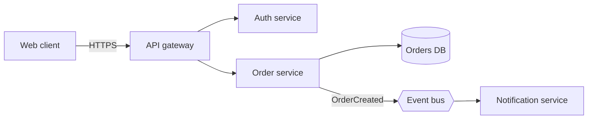

# SDD: Diagram Generator

Pick the right diagram for the question being answered, then draw it simply and correctly.

## Choosing the diagram

| Question | Diagram | Mermaid type |
|----------|---------|--------------|
| What are the big pieces and how do they connect? | System context / architecture | `flowchart` (use subgraphs) |
| What is inside one service? | Component | `flowchart` |
| Who calls whom, in what order? | Sequence | `sequenceDiagram` |
| How does data move? | Data flow (DFD) | `flowchart` |
| How are entities related? | ER | `erDiagram` |
| What states can this object be in? | State | `stateDiagram-v2` |
| How are classes related? | Class (UML) | `classDiagram` |
| Where does it run? | Deployment | `flowchart` with subgraphs per environment |
| What does the user do? | User flow | `flowchart` |

## Workflow
1. Confirm the audience and the one question the diagram answers. A diagram answering three questions answers none well.
2. List nodes and relationships from the document or user description. Do not add components that are not in the source; mark uncertain ones with `[ASSUMPTION]` in a note.
3. Write the Mermaid source. Keep to about 12 nodes; split into a context diagram and a detail diagram when larger.
4. Add a title, a caption line, and a legend if you use colors or line styles.
5. Render check: ensure syntax validity (no unescaped parentheses or quotes in labels; wrap labels with special characters in quotes). If the environment can render, preview it; otherwise provide the source for the user's renderer.
6. If the user needs an image or a polished visual, produce SVG or use the available visual tools instead.

## Example

## Guidance
- Label every edge with the protocol or data when it clarifies meaning.
- Use consistent shapes: rectangles for services, cylinders for stores, hexagons for queues/buses, rounded for external actors.
- Keep the direction consistent (left-to-right for flow, top-to-bottom for hierarchy).
- Always accompany the diagram with a short prose explanation; diagrams supplement text, not replace it.

## Shared conventions (all SDD skills)

- Canonical section numbers: 1 Introduction & Overview, 2 System Architecture, 3 Data Design, 4 Interface Design, 5 Component Design, 6 User Interface Design, 7 Assumptions & Dependencies, 8 Glossary. Appendices: A Traceability Matrix, B Decision Log, C Open Questions. Keep these numbers so sections from different skills assemble cleanly.
- Mark anything you had to infer as `[ASSUMPTION: ...]` and anything missing as `[TBD: ...]`. Never invent facts about the user's system to make a section look complete; a visible gap is more useful to reviewers than a plausible fabrication.
- Give requirements stable IDs (`REQ-001`) and design decisions stable IDs (`DEC-001`) so they can be traced.
- Write in plain language. Define a term the first time it appears or add it to the glossary.
- Output Markdown by default so the section pastes into Confluence, Notion, or a repo. If the user asks for a Word doc, PDF, or Confluence page, use the matching skill or tool for that format after drafting.
